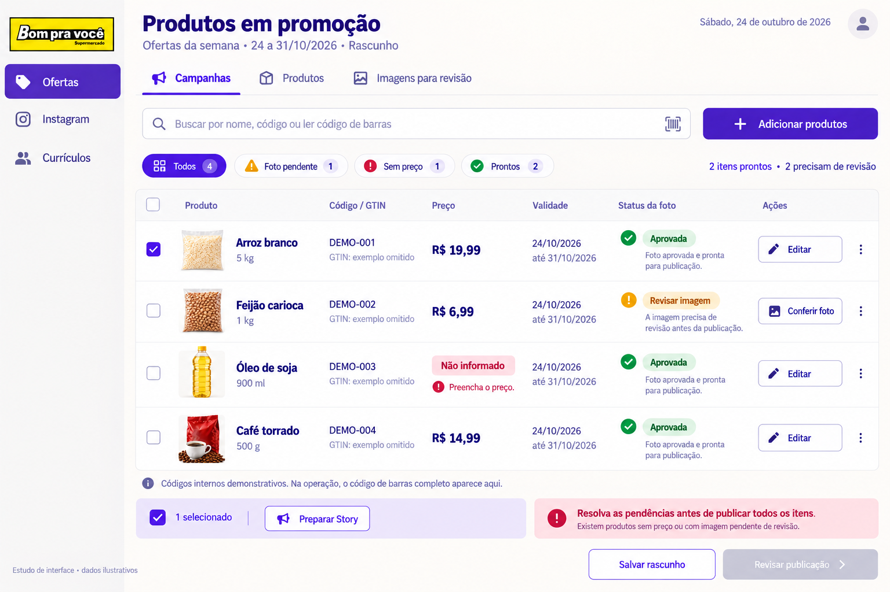
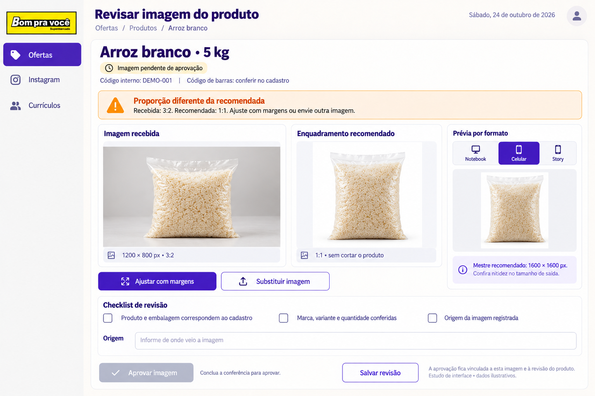

# Galeria — vitrine sazonal e painel local

**Planejamento de 24/10/2026. Sem implementação e sem Feed.**

**Novos materiais de 25/10:** [galeria das 21 decorações separadas](assets-v1/galeria.html) e [guia de integração](assets-v1/README.md). As pranchas abaixo continuam referências conceituais.

21 temas, cada um apresentado em uma prancha com notebook, celular e Story, mais duas telas de controle do painel. As legendas indicam os alvos planejados, não as dimensões reais dos recortes dentro da prancha. Não são artes publicáveis de produtos reais.

[Voltar ao planejamento](README.md) · [Formatos e aprovação](02-imagens-formatos-aprovacao.md) · [Compartilhamento](06-stories-compartilhamento.md)

## Temas

| Nº | Tema | Aplicações |
|---|---|---|
| 1 | [Padrão Bom pra você](../../bom-pra-voce-novo/src/images/offer-themes/padrao/referencias/01-padrao.png) | Notebook, celular e Story |
| 2 | [Verão](../../bom-pra-voce-novo/src/images/offer-themes/verao/referencias/02-verao.png) | Notebook, celular e Story |
| 3 | [Volta à rotina](../../bom-pra-voce-novo/src/images/offer-themes/volta-a-rotina/referencias/03-volta-a-rotina.png) | Notebook, celular e Story |
| 4 | [Carnaval](../../bom-pra-voce-novo/src/images/offer-themes/carnaval/referencias/04-carnaval.png) | Notebook, celular e Story |
| 5 | [Volta às aulas](../../bom-pra-voce-novo/src/images/offer-themes/volta-as-aulas/referencias/05-volta-as-aulas.png) | Notebook, celular e Story |
| 6 | [Mês do consumidor](../../bom-pra-voce-novo/src/images/offer-themes/consumidor/referencias/06-consumidor.png) | Notebook, celular e Story |
| 7 | [Páscoa](../../bom-pra-voce-novo/src/images/offer-themes/pascoa/referencias/07-pascoa.png) | Notebook, celular e Story |
| 8 | [Dia das Mães](../../bom-pra-voce-novo/src/images/offer-themes/maes/referencias/08-maes.png) | Notebook, celular e Story |
| 9 | [Festa junina](../../bom-pra-voce-novo/src/images/offer-themes/festa-junina/referencias/09-festa-junina.png) | Notebook, celular e Story |
| 10 | [Dia dos Namorados](../../bom-pra-voce-novo/src/images/offer-themes/namorados/referencias/10-namorados.png) | Notebook, celular e Story |
| 11 | [Férias](../../bom-pra-voce-novo/src/images/offer-themes/ferias/referencias/11-ferias.png) | Notebook, celular e Story |
| 12 | [Inverno](../../bom-pra-voce-novo/src/images/offer-themes/inverno/referencias/12-inverno.png) | Notebook, celular e Story |
| 13 | [Dia dos Pais](../../bom-pra-voce-novo/src/images/offer-themes/pais/referencias/13-pais.png) | Notebook, celular e Story |
| 14 | [Primavera](../../bom-pra-voce-novo/src/images/offer-themes/primavera/referencias/14-primavera.png) | Notebook, celular e Story |
| 15 | [Setembro Amarelo](../../bom-pra-voce-novo/src/images/offer-themes/setembro-amarelo/referencias/15-setembro-amarelo.png) | Notebook, celular e Story |
| 16 | [Dia das Crianças](../../bom-pra-voce-novo/src/images/offer-themes/criancas/referencias/16-criancas.png) | Notebook, celular e Story |
| 17 | [Outubro Rosa](../../bom-pra-voce-novo/src/images/offer-themes/outubro-rosa/referencias/17-outubro-rosa.png) | Notebook, celular e Story |
| 18 | [Black Friday](../../bom-pra-voce-novo/src/images/offer-themes/black-friday/referencias/18-black-friday.png) | Notebook, celular e Story |
| 19 | [Natal](../../bom-pra-voce-novo/src/images/offer-themes/natal/referencias/19-natal.png) | Notebook, celular e Story |
| 20 | [Ano-Novo](../../bom-pra-voce-novo/src/images/offer-themes/ano-novo/referencias/20-ano-novo.png) | Notebook, celular e Story |
| 21 | [Aniversário da loja](../../bom-pra-voce-novo/src/images/offer-themes/aniversario-loja/referencias/21-aniversario-loja.png) | Notebook, celular e Story |

Setembro Amarelo e Outubro Rosa apresentam Story institucional separado. As ofertas desses períodos podem usar a composição comercial padrão. Todas as datas e mercadorias são exemplos.

## Painel

| Tela | Objetivo |
|---|---|
| [Lista de produtos](../../bom-pra-voce-novo/src/images/offer-themes/painel/referencias/22-painel-lista-produtos.png) | Buscar por código, identificar pendências e selecionar itens da campanha |
| [Revisão de imagem](../../bom-pra-voce-novo/src/images/offer-themes/painel/referencias/23-painel-revisao-imagem.png) | Comparar proporção, ajustar com margens e conferir aprovação |

## Leitura crítica dos estudos

- A seção será inserida abaixo dos banners atuais. Cabeçalhos e rodapés decorativos das imagens devem respeitar os limites compactos da especificação; não viram novos banners.
- A imagem gerada pode aproximar o logo e inserir elementos de cenário. Na futura produção, aplicar o arquivo original do logo e manter fotos aprovadas separadas dos enfeites.
- As etiquetas não representam promoção real. Não publicar os preços, códigos ou produtos fictícios.
- Em Setembro Amarelo, a chamada desenhada com aparência de botão no Story é apenas uma aproximação visual; deve virar texto simples na arte final. Um botão desenhado não cria link/sticker.
- Símbolos de porcentagem em alguns temas são decoração conceitual; não apresentar desconto sem preço anterior e cálculo comprovados. Preferir removê-los do kit final quando não houver desconto validado.
- O painel demonstra códigos internos fictícios; na operação, mostrar e conferir o código de barras completo do cadastro. Aprovação da foto não substitui validação do produto e da oferta.
- Zonas seguras, contraste e proporção final precisam de validação no renderizador e em aparelhos reais.
- As dimensões reais e os hashes dos PNGs estão no inventário. São pranchas de estudo, não arquivos 1080×1920 individuais.

## Prévias do painel

